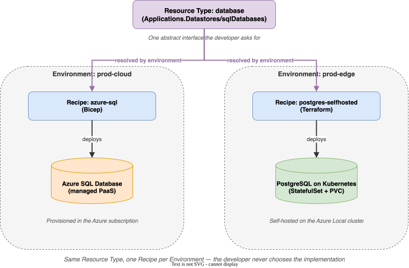
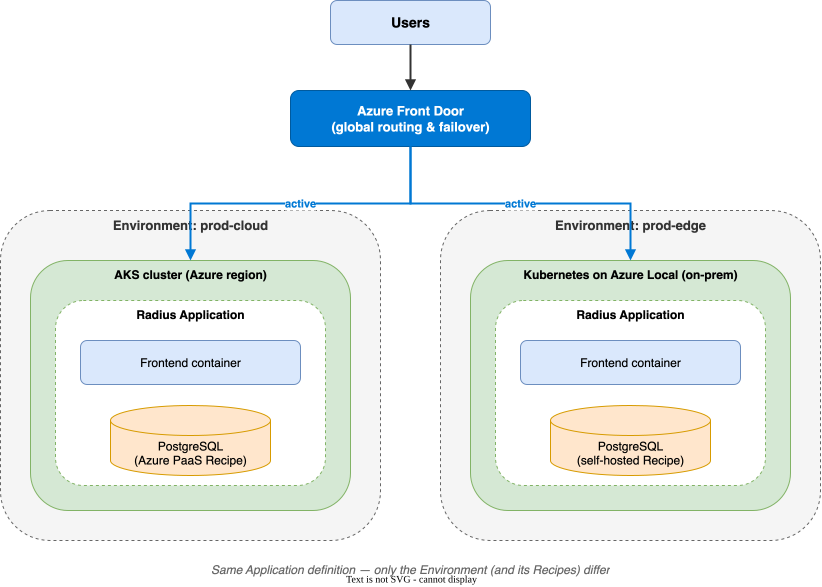

## The gap between developers and infrastructure

If you have ever built an internal developer platform (IDP), you know the tension. Developers just want to ship an application: a container, a database, maybe a message queue. Platform engineers want to make sure that database is the right SKU, in the right region, with the right networking, tagging, and security baseline applied. Somewhere in the middle, developers end up copy-pasting Bicep or Terraform modules they do not fully understand, and platform engineers end up reviewing pull requests full of low-level infrastructure they wish developers never had to touch.

[Radius](https://radapp.io/) is an open-source, multi-cloud cloud-native application platform that tries to close this gap. Its core idea is deceptively simple: **separate the definition of a resource from the deployment of that resource.**

Reference: [Radius documentation](https://docs.radapp.io/)

## Definition versus deployment

Instead of a developer asking for an *Azure Database for PostgreSQL Flexible Server* (which is obviously only deployable to Azure), they ask for an abstract *PostgreSQL database*. How that database is actually created, on Azure, AWS, or locally on Kubernetes, is a swappable implementation owned by the platform team.

This separation gives you a few nice properties:

- Developers work with the right level of abstraction and skip the low-level details.
- Platform engineers keep full control over security, cost, and operational best practices.
- Applications stay portable between cloud providers and container platforms.
- The work of building applications is cleanly separated from the work of building infrastructure.

## The core building blocks

Radius is built around a small set of concepts. What I like is that each one has a clear owner, either the platform engineer or the developer.

### Resource Types (platform engineer)

A **Resource Type** is the interface, or contract, between developers and the platform. It is abstract and application-oriented: think "a PostgreSQL database" rather than "an Azure Flexible Server". A Resource Type is defined by its name, API version, and a schema of required and optional properties. There is exactly one Resource Type per application resource, so developers always know what to ask for.

### Recipes (platform engineer)

If Resource Types define the interface, **Recipes** define the implementation. A Recipe is just a Terraform configuration or a Bicep template that knows how to actually deploy the resource. The beauty here is that Recipes are not tightly coupled to Radius; in most cases you can take an existing Terraform module or Bicep template and use it as a Recipe with only minor changes to map properties to variables or parameters.

### Environments (platform engineer)

An **Environment** is where Resource Types, Recipes, and cloud providers come together. It is the landing zone for applications: a Kubernetes namespace, an AWS account and region, or an Azure subscription and resource group. Crucially, the Environment also maps each Resource Type to a specific Recipe. That means your `dev` environment can deploy a PostgreSQL database as a lightweight container, while `prod` deploys the same abstract database as a hardened managed service, without the developer changing a single line.



The diagram makes the indirection concrete: the developer asks for a single `database` Resource Type, but each Environment resolves it to a different Recipe. In `prod-cloud` that Recipe is a Bicep template provisioning an Azure SQL Database, while in `prod-edge` it is a Terraform module that runs PostgreSQL on Kubernetes. Same interface, swappable implementation — chosen entirely by the Environment.

### Applications (developer)

Here is the part I find most refreshing. When you deploy to Kubernetes, the notion of an "application" usually gets lost; you end up with a flat list of resources and, if you are lucky, some annotations. Radius makes the **Application** a first-class resource. Developers define an Application, then attach resources such as containers and databases to it. Everything belongs to an Application, which makes it far easier for developers and SREs to understand what belongs to what, and to visualize it as a dependency graph in the dashboard.

## How it fits together


flowchart TD
    subgraph Platform["Platform engineer"]
        RT["Resource Type<br/>the interface"]
        R["Recipe<br/>Terraform / Bicep"]
        E["Environment<br/>landing zone"]
    end
    subgraph Dev["Developer"]
        A["Application<br/>containers + resources"]
    end
    RT --> E
    R --> E
    A -->|deployed to| E
    E -->|implements resources via| R


The developer references an abstract Resource Type in their Application. When that Application is deployed to an Environment, Radius looks up the Recipe assigned to that Resource Type in that Environment and runs the underlying Terraform or Bicep to create the real infrastructure.

## Where Environments really shine

The concept page makes Environments sound like a simple `dev`/`prod` switch, but in practice this is where I think Radius earns its keep. Because an Environment owns both the deployment target *and* the Recipe mapping, the exact same Application definition can land on wildly different infrastructure without the developer knowing. A few patterns I have found genuinely useful:

### Local development, cloud production

The obvious starting point, but still a big quality-of-life win. You define two Environments that share the same Resource Types:

- **`dev`** targets a local Kubernetes cluster (kind, k3d, or Docker Desktop). Its Recipe for a "PostgreSQL database" is a lightweight container running in the same namespace. No cloud credentials, no cost, spins up in seconds.
- **`prod`** targets an Azure subscription and resource group. The Recipe for that same "PostgreSQL database" is a Bicep template that provisions an Azure Database for PostgreSQL Flexible Server with private networking, backups, and the right SKU.

The developer runs `rad deploy app.bicep` against `dev` on their laptop and against `prod` in the pipeline. The Application file is byte-for-byte identical; only the Environment (and therefore the Recipe) changes. That is a much stronger guarantee than "it worked on my machine" because the *application topology* is provably the same in both places.

### Active/active across AKS and Azure Local

This is the pattern I am most excited about. If you run a hybrid estate, an Environment does not have to map to a single cloud. You can define two production Environments that back the *same* application:

- **`prod-cloud`** targets an **AKS** cluster in an Azure region.
- **`prod-edge`** targets a **Kubernetes cluster running on Azure Local** (formerly Azure Stack HCI) in your own datacenter.

Both Environments expose the same Resource Types, but their Recipes differ where the infrastructure differs. A managed service on AKS might be an Azure PaaS resource, while on Azure Local the same Resource Type is implemented as a self-hosted workload on the cluster. Deploy the identical Application to both, put a global load balancer or DNS-based traffic manager in front, and you get an **active/active** topology spanning cloud and on-prem — with a single application definition as the source of truth.



In the diagram above, **Azure Front Door** sits in front as the global entry point and handles routing and failover across both regions. Each side is its own Radius Environment: `prod-cloud` on AKS and `prod-edge` on Azure Local. The Application is identical on both — only the Recipe behind the `PostgreSQL` Resource Type changes, from an Azure PaaS database in the cloud to a self-hosted one at the edge.

What makes this practical is exactly the separation of definition from deployment. Without it, an active/active hybrid setup usually means maintaining two divergent sets of IaC that slowly drift apart. With Radius, the drift lives where it belongs: inside the Recipes owned by the platform team, not in the application.

### What this looks like in Radius Bicep

Talk is cheap, so here is the concrete part. A developer describes the application once in Bicep, using the `radius` extension. Notice there is not a single Azure or Kubernetes detail in here — just a container and an abstract database it connects to:

```bicep
extension radius

@description('The Radius Application ID. Injected automatically by the rad CLI.')
param application string

@description('The Radius Environment to deploy into. Injected automatically by the rad CLI.')
param environment string

resource frontend 'Applications.Core/containers@2023-10-01-preview' = {
  name: 'frontend'
  properties: {
    application: application
    container: {
      image: 'ghcr.io/myorg/store-frontend:latest'
      ports: {
        web: {
          containerPort: 3000
        }
      }
    }
    connections: {
      // Radius injects CONNECTION_DATABASE_* env vars into the container
      database: {
        source: db.id
      }
    }
  }
}

resource db 'Applications.Datastores/sqlDatabases@2023-10-01-preview' = {
  name: 'db'
  properties: {
    application: application
    environment: environment
    // No server, SKU, or connection string here.
    // The Environment's Recipe decides how this database is really created.
  }
}
```

The important line is `environment: environment` on the database. That is the hook that tells Radius: "when you materialize this database, use whatever Recipe this Environment has registered for `Applications.Datastores/sqlDatabases`." The developer never picks Azure PaaS or a self-hosted container — they just ask for a database.

The platform engineer is the one who wires each Environment to a different Recipe. That is a one-time setup per Environment:

```bash
# prod-cloud (AKS): the database Recipe provisions Azure Database for PostgreSQL
rad recipe register default \
  --environment prod-cloud \
  --resource-type Applications.Datastores/sqlDatabases \
  --template-kind bicep \
  --template-path ghcr.io/myorg/recipes/azure-postgres:1.0.0

# prod-edge (Azure Local): the same resource type maps to a self-hosted Postgres Recipe
rad recipe register default \
  --environment prod-edge \
  --resource-type Applications.Datastores/sqlDatabases \
  --template-kind terraform \
  --template-path git::https://github.com/myorg/recipes//postgres-selfhosted
```

With that in place, the exact same file deploys to both sides of the diagram:

```bash
rad deploy app.bicep --environment prod-cloud
rad deploy app.bicep --environment prod-edge
```

Same application, same connection wiring, two very different databases underneath — an Azure managed service in the cloud and a self-hosted one at the edge. The `frontend` container does not care: it just reads the `CONNECTION_DATABASE_*` environment variables that Radius injects, whichever Recipe produced them.

### Promotion is just changing the target Environment

A nice side effect of all this: promoting a release is not a rewrite, it is pointing the same Application at the next Environment. `dev` to `staging` to `prod-cloud` to `prod-edge` becomes a linear path where each hop swaps the landing zone and its Recipes, never the application contract.

## A quick look at the developer experience

The primary tool is the Radius CLI, `rad`. It uses your current Kubernetes context to find the Radius control plane, so there is no separate endpoint to configure. Getting hands-on looks roughly like this:

```bash
# Install the CLI, then initialize Radius on your current cluster
rad install kubernetes

# Initialize a new application in the current directory
rad init

# Deploy your application definition to the current environment
rad deploy app.bicep

# See the deployed application and its resources
rad app graph
```

Behind the scenes a lot is happening: the Universal Control Plane (UCP) exposes a REST API through the Kubernetes API Aggregation Layer, which means access control is just Kubernetes RBAC. A Deployment Engine works out the dependency order of your resources, and the Applications Resource Provider ultimately runs the Terraform or Bicep CLI to do the real work.

## Things worth knowing

A few practical details stood out to me while reading through the docs:

- **Credentials stay with the platform.** Resources are deployed using Radius' own Kubernetes, AWS, or Azure credentials stored in the control plane, not the developer's. That means platform engineers can require that resources only ever get deployed through Radius.
- **Recipes are not run from your laptop.** Terraform configurations live in a Git repository and Bicep templates live in an OCI registry. Radius pulls them from there, never from your local file system.
- **CI/CD today is Flux.** GitOps deployments run through Flux, with ArgoCD planned for the future.
- **The dashboard is Backstage-based.** Developers browse available Resource Types and Environments and visualize their deployed applications from a familiar portal.

## The rough edges (from my own experience)

I do not want to oversell this. The model is elegant on paper, but in day-to-day use there are a few things that still put more on the developer's plate than I would like:

- **Recipe versions are not invisible.** In theory the Recipe is the platform team's concern. In practice, when a Recipe ships a new version, that change often ripples back to the developer — you end up bumping a version, re-testing, and redeploying rather than the platform simply rolling it forward for you. The promise is "you just ask for a database"; the reality today is closer to "you ask for a database, and you keep an eye on which Recipe version you are pinned to."
- **Local setup is still heavy.** Getting a productive local loop going means installing the `rad` CLI, a local Kubernetes cluster, the Radius control plane, wiring up your Environment, and making sure your Recipes are reachable. That is a lot of moving parts before you write a single line of application code. For a platform that is meant to hide infrastructure from developers, the on-ramp still asks developers to understand a fair amount of infrastructure.
- **The abstraction leaks under pressure.** The moment you need something the Resource Type does not expose, you are back to editing Recipes or reaching for Kubernetes pod patching — which is powerful, but it is exactly the low-level detail the model set out to hide.

None of this is a dealbreaker, and the project is moving quickly, so I fully expect some of these to improve. But if you are evaluating Radius, go in with clear eyes: the clean separation is real, and so is the setup cost. I would love to see a future where Recipe upgrades are genuinely transparent to developers and the local bootstrap is a single command.

## Why I think this matters

Most IDP conversations end up bogged down in tooling. Radius reframes the problem around a clean contract: platform engineers own the *what and how* of infrastructure, developers own the *application*. By making the application a first-class citizen and pushing the messy IaC details behind swappable Recipes, it gives both sides something they actually want. Whether it becomes the default way to build IDPs remains to be seen, but the separation of definition from deployment is a pattern worth stealing regardless.

If you want to try it yourself, the [Radius Quick Start](https://docs.radapp.io/quick-start/) is the fastest way in.

## References

- [Radius documentation](https://docs.radapp.io/)
- [Radius concepts](https://docs.radapp.io/concepts/)
- [Radius Quick Start](https://docs.radapp.io/quick-start/)
